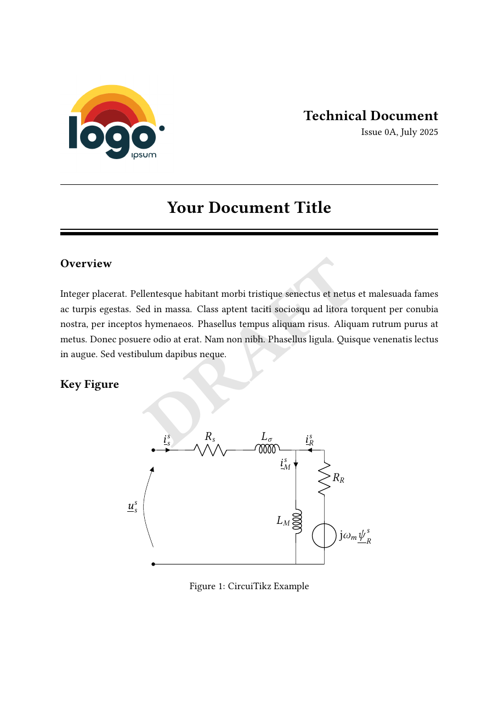
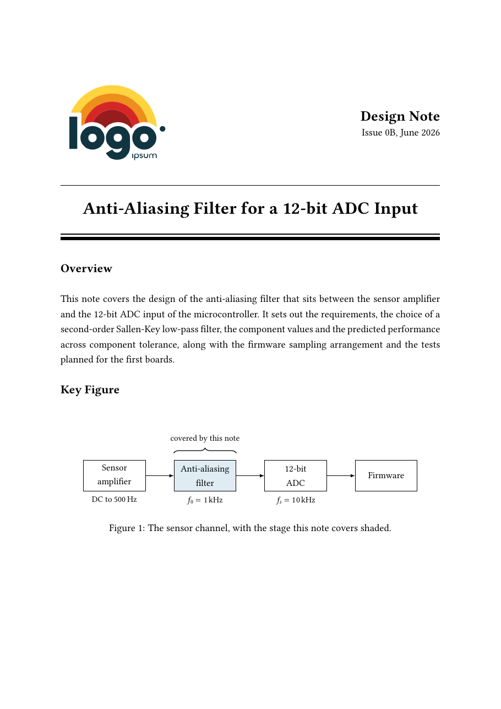
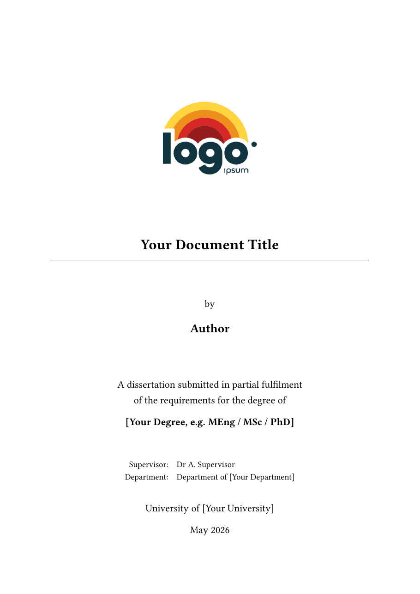

# Technical Document Template

A LaTeX template for technical documents, such as engineering reports,
specifications, research write-ups, teaching material and university
dissertations. The title page, revision control, contents, numbered sections,
references and appendices are already set up and styled, so you can get on with
the writing and not the formatting.

The example content has an electronics theme, because that is what I use it
for, but nothing in the template is tied to one field. Swap the examples for
your own.

<p align="center">
  
</p>

## Contents

- [Quick start](#quick-start)
- [Worked examples](#worked-examples)
- [What the built document contains](#what-the-built-document-contains)
- [How the files fit together](#how-the-files-fit-together)
- [Writing your document](#writing-your-document)
- [Draft mode](#draft-mode)
- [Building](#building)
- [Using it for a dissertation](#using-it-for-a-dissertation)
- [Slimming it down](#slimming-it-down)
- [If something goes wrong](#if-something-goes-wrong)
- [Requirements](#requirements)

## Quick start

1. Install a TeX distribution, either TeX Live 2021 or later, or an up-to-date
   MiKTeX. If you would rather not install anything, use
   [Overleaf](#on-overleaf).
2. Copy this folder to wherever your document will live, and rename it.
3. Build it once before you change anything, so you know your setup works:

   ```bash
   latexmk -pdf main
   ```

   You should get a 10-page `main.pdf` with a grey DRAFT watermark across each
   page.
4. Open `preamble/metadata.tex` and set the title, issue, date, author and
   company name.
5. Replace the example text in `content/sections/introduction.tex` with your
   own, and build again.

That is enough for a first document. The rest of this page explains where
everything lives and how to add to it.

## Worked examples

Two finished documents are included, so you can see what the template looks
like with real content in it and not placeholder text.

| | Technical document | Dissertation |
|---|---|---|
| What it is | A design note for an anti-aliasing filter in front of a 12-bit ADC | A dissertation on getting more resolution from an ADC by oversampling |
| Length | 15 pages | 24 pages |
| Built PDF | [technical-document-example.pdf](examples/technical-document-example.pdf) | [dissertation-example.pdf](examples/dissertation-example.pdf) |
| Source | [examples/technical-document](examples/technical-document) | [examples/dissertation](examples/dissertation) |

<p align="center">
  
  
</p>

They are there to show how a finished document looks, and how the template is
used to make one. The company, the university and the author in them are made
up. [examples/README.md](examples/README.md) has more on them.

Between them they use most of what the template offers:

- The design note has a revision table with two issues, a requirements table,
  a circuit, a response plotted from its equation, a timing diagram, a C
  listing, a test plan and a derivation in an appendix.
- The dissertation has the dissertation front matter switched on, tables and
  plots built straight from the simulation's CSV files, a code listing pulled
  from the real source file, and two appendices.

Each example folder is a complete project, so you can take one as it is and
use it as the start of your own document. Build it from inside its folder in
the usual way:

```bash
latexmk -pdf main
```

## What the built document contains

The parts appear in this order. Each one comes from a file you can edit, or is
generated for you.

| Part | Where it comes from |
|---|---|
| Title page | `content/frontmatter/titlepage/titlePage.tex`, filled in from `preamble/metadata.tex` |
| Revision control table | `content/frontmatter/revisionControl.tex` |
| Table of contents | Generated from your headings |
| Lists of figures and tables | Generated from your captions |
| Nomenclature | `content/frontmatter/nomenclature.tex` |
| Sections | The files in `content/sections/` |
| References | `bib/mybib.bib`, but only the entries you cite |
| Appendices | The files in `content/appendices/` |

The front matter is numbered in Roman numerals (I, II, III) and the body starts
again from page 1.

## How the files fit together

`main.tex` is the only file you compile. It holds no content of its own, it
pulls everything else in with `\input`: first the files in `preamble/`, which
set the document up, then the front matter, your sections, the references and
the appendices.

```text
main.tex                      the file you compile, lists everything below
.latexmkrc                    tells latexmk how to build the nomenclature

preamble/                     setup, loaded before the document starts
  packages.tex                every \usepackage, in one place
  metadata.tex                title, issue, date, author, logo, and the on/off switches
  macros.tex                  shortcuts such as \Vin, \dd and \todo
  layout.tex                  table helpers, heading and contents depth
  header-footer.tex           what runs along the top and bottom of each page
  styling.tex                 colours, link colours, code listing style
  watermark.tex               the DRAFT overlay

content/
  frontmatter/
    frontmatter.tex           the order of the front matter
    titlepage/
      titlePage.tex           the standard title page
      overview.tex            the overview paragraph on the title page
      titlePage-dissertation.tex
    revisionControl.tex       the revision table
    lists.tex                 lists of figures and tables
    nomenclature.tex          your symbols and abbreviations
    abstract.tex              off by default
    acknowledgements.tex      off by default
    declaration.tex           off by default, for dissertations
  sections/                   the body of the document, one file per section
  appendices/                 one file per appendix

assets/
  logos/                      the logo on the title page
  figures/                    one file per figure (circuits, plots, timing diagrams)
  code/                       one file per code listing, grouped by language

bib/mybib.bib                 your references
examples/                     two worked examples, as built PDFs and as source
LINKS.md                      editors and package documentation I find useful
```

You will not need most of these for most documents. As a guide:

| How often | Files |
|---|---|
| Every document | `preamble/metadata.tex`, `titlepage/overview.tex`, the files in `content/sections/`, `main.tex` (to list your sections), `revisionControl.tex` |
| When you need them | `bib/mybib.bib`, `nomenclature.tex`, `preamble/macros.tex` |
| Rarely | `packages.tex`, `layout.tex`, `header-footer.tex`, `styling.tex`, `watermark.tex`, `frontmatter.tex`, `titlePage.tex` |

## Writing your document

### Document details

Everything that changes from one document to the next is in
`preamble/metadata.tex`, so you never have to hunt through the layout files to
change a title or a date.

| Field | What it is | Where it shows |
|---|---|---|
| `\documentType` | The kind of document, for example "Test Report" | Top right of the title page |
| `\documentTitle` | The title | Title page, centre of the footer, the PDF's title |
| `\documentShortTitle` | A shorter title, for when the full one is too long for the footer | Centre of the footer, in place of the full title |
| `\issueNumber` | The current issue | Title page, left of the footer, revision table |
| `\releaseDate` | The date of that issue | Title page, revision table |
| `\authorName` | You, or your team | The PDF's author, and the dissertation pages |
| `\companyName` | Your company or organisation | Left of the header |
| `\documentNumber` | An internal document number | Nowhere by default, `preamble/header-footer.tex` shows where to add it to the header |
| `\logoPath`, `\logoWidth` | The logo file and how wide to draw it | Title page |
| `\keyFigurePath` | The figure shown at the bottom of the title page | Title page |

The same file holds the switches that turn parts of the document on and off,
which are covered under [Leaving parts out](#leaving-parts-out),
[Draft mode](#draft-mode) and
[Using it for a dissertation](#using-it-for-a-dissertation).

### The title page

The title page takes its text from `metadata.tex`, apart from two things. The
overview paragraph is in `content/frontmatter/titlepage/overview.tex`, so
replace the placeholder there with a few sentences on what the document covers.
The key figure at the bottom is one of your figure files, named by
`\keyFigurePath` in `metadata.tex`:

```latex
\newcommand*{\keyFigurePath}{assets/figures/diagrams/blockDiagram}
```

Leave the braces empty if you do not want one, and the heading goes along with
the figure.

To use your own logo, put the file in `assets/logos/` and change `\logoPath`.
Logos come in different shapes, so adjust `\logoWidth` until it looks right.

### Adding a section

Each section is its own file in `content/sections/`, which keeps `main.tex`
short and makes it easy to reorder things. To add one:

1. Create a file, for example `content/sections/design.tex`, that starts with
   its heading:

   ```latex
   \section{Design}
   \label{sec:design}

   Your text here.
   ```

2. Add it to `main.tex`, where the existing section is listed:

   ```latex
   \input{content/sections/design}
   \clearpage
   ```

The `\clearpage` starts the next section on a new page, leave it out if you
would rather the sections ran on. The template uses the `article` class, so the
top level is `\section`, not `\chapter`. Headings are numbered and listed in
the contents four levels deep, down to `\paragraph`, which you can change at
the bottom of `preamble/layout.tex`.

### Figures, plots and diagrams

Each figure is a small file of its own under `assets/figures/`, holding the
whole `figure` environment with its caption and label. You then pull it in
where you want it:

```latex
\input{assets/figures/plots/examplePlot}
```

Keeping figures in their own files means a long plot or circuit does not get
in the way when you are reading the text around it. There are three examples
to copy from: a plot drawn with `pgfplots`, a circuit drawn with `circuitikz`
and a timing diagram drawn with `tikz-timing`.

For a photo or a screenshot, the file looks like this:

```latex
\begin{figure}[htbp]
  \centering
  \includegraphics[width=0.8\linewidth]{assets/figures/images/bench-setup.png}
  \caption{The bench setup used for the measurements.}
  \label{fig:bench-setup}
\end{figure}
```

### Code listings

Code works the same way as figures, with one file per listing under
`assets/code/`, grouped by language. `assets/code/C/codeExample.tex` is the
example to copy. Give the listing a caption, a label and its language, and
the template handles the line numbers and colours:

```latex
\begin{lstlisting}[caption={Blink}, label={lst:blink}, language=C]
// your code here
\end{lstlisting}
```

### Units and maths

Write quantities with `siunitx`, so the spacing and unit symbols stay
consistent through the whole document: `\qty{330}{\ohm}` for a number with a
unit, and `\unit{\milli\ampere}` for a unit on its own.

`preamble/macros.tex` has a few shortcuts, `\Vin`, `\Vout`, `\Vcc`, `\Vdd` and
`\Gnd` for the usual supply names, and `\dd`, `\dv{f}{x}` and `\pdv{f}{x}` for
derivatives. They are only examples, so delete the ones you do not use and add
your own there.

### Cross-references

Label a heading, figure, table, listing or equation once with `\label{...}`,
then refer to it by that label and let LaTeX keep the numbers right:

| You write | You get |
|---|---|
| `\cref{fig:bench-setup}` | fig. 2 |
| `\Cref{fig:bench-setup}` | Figure 2, for the start of a sentence |
| `\vref{fig:bench-setup}` | fig. 2 on the next page |
| `\Vref{fig:bench-setup}` | Figure 2 on the next page |

These commands write the word "figure" or "section" for you, so do not type it
yourself or it will appear twice. A reference to an appendix comes out as
"appendix A".

### References

Add your sources to `bib/mybib.bib` and cite them in the text with
`\cite{key}`. Only the sources you cite are printed, as a numbered list in IEEE
style, in the order you first cite them. To use a different style, change the
`\bibliographystyle` line in `main.tex`.

### Nomenclature

List your symbols and abbreviations in
`content/frontmatter/nomenclature.tex`, one line each. They are sorted for
you.

```latex
\nomenclature{ADC}{Analogue-to-Digital Converter}
\nomenclature{$R_E$}{Emitter resistor}
```

### Revision history

The table is in `content/frontmatter/revisionControl.tex`. Its first row takes
the issue and date from `metadata.tex`, so it always shows the current issue
and only needs its description writing.

When you raise a new issue, write the outgoing one in as a plain row above it,
so the history stays in order, then update `\issueNumber` and `\releaseDate`
in `metadata.tex`:

```latex
0A & July 2025 & Initial issue. \\
\hline
\issueNumber & \releaseDate & Added the test results. \\
```

### Appendices

Appendices work like sections. Add a file to `content/appendices/` that starts
with `\section{...}`, and list it in `main.tex` after the `\appendix` line.
They are lettered A, B, C for you.

### Leaving parts out

The revision table, the lists of figures and tables, and the nomenclature each
have a switch near the top of `preamble/metadata.tex`. Change `true` to `false`
on the end of the name to leave that part out:

```latex
\newif\ifshowrevisions        \showrevisionstrue          % revision control table
\newif\ifshowlists            \showlistsfalse             % lists of figures and tables
\newif\ifshownomenclature     \shownomenclaturetrue       % nomenclature
```

In that example the lists of figures and tables are switched off. Nothing else
needs editing. `content/frontmatter/frontmatter.tex` only needs opening if you
want the parts in a different order.

## Draft mode

`preamble/metadata.tex` has a switch near the top:

```latex
\draftmodetrue    % while you are writing
\draftmodefalse   % for the finished document
```

With draft mode on, every page carries the DRAFT watermark, and you can leave
yourself notes with `\todo{check this value}`, which print in red. Switch it
off for the finished document and the watermark goes and the notes disappear
from the PDF, although they stay in your source.

## Building

### With latexmk

```bash
latexmk -pdf main
```

This is the easiest way, as it works out how many passes are needed and runs
the references and nomenclature steps for you. The `.latexmkrc` file in this
folder is what tells it about the nomenclature.

To clear out the build files afterwards, run `latexmk -c`, or `latexmk -C` to
remove the PDF as well.

### By hand

If you do not have `latexmk`, these five commands do the same job:

```bash
pdflatex main
bibtex main
makeindex main.nlo -s nomencl.ist -o main.nls
pdflatex main
pdflatex main
```

### On Overleaf

Zip the folder, then in Overleaf choose New Project and Upload Project. Set the
compiler to pdfLaTeX and the main document to `main.tex`, and it should build
without any other changes.

## Using it for a dissertation

The template also has a dissertation title page, a declaration of authorship,
an abstract and acknowledgements. They are switched off by default. The
dissertation in [Worked examples](#worked-examples) has all four switched on,
so you can see the result first, and its `metadata.tex` shows the changes
described below.

Everything is done in `preamble/metadata.tex`:

1. Switch the four parts on, by changing `false` to `true` on each. A
   dissertation has no revision table, so switch that one off:

   ```latex
   \newif\ifshowrevisions        \showrevisionsfalse         % revision control table

   \newif\ifdissertationtitle    \dissertationtitletrue      % dissertation title page
   \newif\ifshowdeclaration      \showdeclarationtrue        % declaration of authorship
   \newif\ifshowabstract         \showabstracttrue           % abstract
   \newif\ifshowacknowledgements \showacknowledgementstrue   % acknowledgements
   ```

2. Fill in the dissertation fields further down: supervisor, department,
   university, degree and submission date, along with your name in
   `\authorName`.
3. If your title is long, give a shorter one in `\documentShortTitle` for the
   footer.
4. Write your abstract and acknowledgements in `abstract.tex` and
   `acknowledgements.tex`, in `content/frontmatter/`.
5. Set `\draftmodefalse` before you submit.

The dissertation fields come with placeholder values, such as
`Dr A. Supervisor`, so the title page builds straight away. If you delete a
field, a bracketed note such as `[supervisor name]` is printed in its place, so
the page still builds and the gap is easy to spot.

The wording in `declaration.tex` follows a common UK form, but universities
differ, so check it against what yours requires.

If the dissertation will be printed and bound, it needs a wider inner margin
for the binding. There is a second, commented `geometry` block in
`preamble/packages.tex` for this, so swap it for the first one.

## Slimming it down

The template loads more packages than any one document needs, so that the
common things work without you having to go looking for a package. The ones
you can safely remove are marked `[OPTIONAL]` in `preamble/packages.tex`.

If your document has no circuits or timing diagrams, remove `circuitikz` and
`tikz-timing`, delete the examples that use them from
`content/sections/introduction.tex`, and empty `\keyFigurePath` in
`metadata.tex`, as the example key figure is a circuit. Otherwise the build
will stop on the missing commands. `blindtext` and `lipsum`
only produce placeholder text, so they can go once your own text is in.

`minted` gives better-looking code than `listings`, but it is commented out
because it needs Python with Pygments installed, and a build with
`-shell-escape`. Uncomment it in `packages.tex` if you want it.

## If something goes wrong

| What you see | Why, and what to do |
|---|---|
| The nomenclature page is empty or missing | The `makeindex` step did not run. Build with `latexmk`, or run the five commands under [By hand](#by-hand) |
| Citations show as `[?]` | `bibtex` has not run, or the two passes after it have not. Build with `latexmk` |
| References show as `??` | LaTeX needs another pass to settle the numbers. Build again |
| `Undefined control sequence \qty` | Your `siunitx` is older than version 3. Update your TeX distribution |
| The logo is not found | Check `\logoPath` in `metadata.tex`. File names are case sensitive on Linux and Overleaf, so `Logo.png` and `logo.png` are different files |
| The title runs into the text either side of it in the footer | The title is too long for the centre of the footer. Give a shorter one in `\documentShortTitle` in `metadata.tex`, which is used in the footer only |
| Errors mentioning `minted` | It needs Pygments and a build with `-shell-escape`, see [Slimming it down](#slimming-it-down) |

## Requirements

- TeX Live 2021 or later, or an up-to-date MiKTeX. It has to be that recent
  because `\qty` needs `siunitx` version 3 and the plots need `pgfplots` 1.18,
  which both arrived in 2021.
- It builds with pdfLaTeX.
- Every package it uses, and the `IEEEtran` reference style, is part of a full
  TeX Live install. MiKTeX will offer to install any that are missing the
  first time you build.

[LINKS.md](LINKS.md) has the editors and package documentation I find useful
when working with it.
